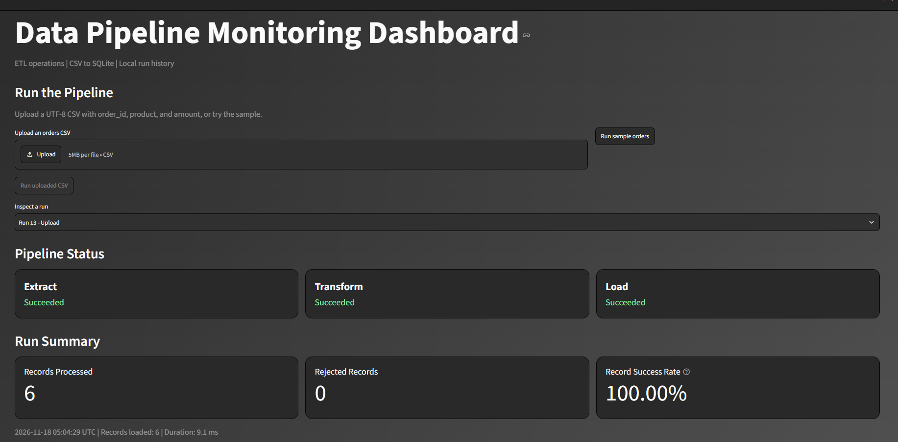
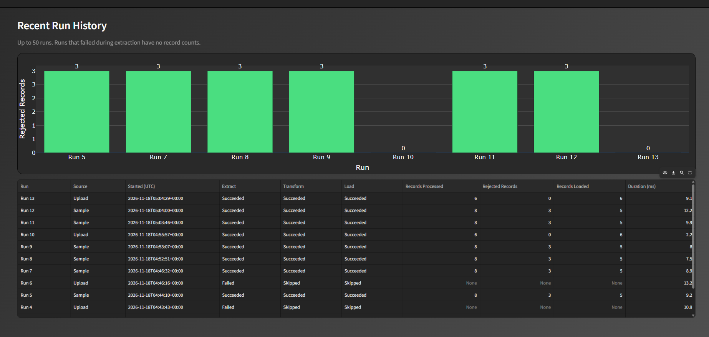

<div align="center">

# Data Pipeline Monitoring Dashboard

A local ETL demo for running, inspecting, and monitoring CSV-to-SQLite data pipelines.


</div>

## Overview

Run the bundled sample or upload an orders CSV, then inspect each pipeline stage, record counts, rejected-row details, and recent run history. The dashboard reads real results from the local ETL pipeline; it does not simulate metrics.

- **Extract** — Read and validate a UTF-8 CSV.
- **Transform** — Clean and validate rows, and report rejected records.
- **Load** — Save valid orders to SQLite, storing amounts as integer cents.
- **Monitor** — Record stage statuses, counts, duration, and a result summary for each run.
## Screenshots

### Pipeline run



### Recent run history



## Getting started

You need Python and pip installed. From the project directory, create a virtual environment, install dependencies, and start Streamlit:

**Windows (PowerShell)**

```powershell
py -m venv .venv
.\.venv\Scripts\python.exe -m pip install -r requirements.txt
.\.venv\Scripts\python.exe -m streamlit run app.py
```

**macOS / Linux**

```bash
python3 -m venv .venv
.venv/bin/python -m pip install -r requirements.txt
.venv/bin/python -m streamlit run app.py
```

Open the Local URL printed in your terminal. Select **Run sample orders** to try the included data: the sample produces **8 processed, 3 rejected, and 5 loaded**. To process your own data, upload a CSV and select **Run uploaded CSV**.

## CSV format

Upload a UTF-8 CSV no larger than 5 MB with exactly these columns (column order does not matter). See [`sample_orders.csv`](./sample_orders.csv) for a complete example.

```csv
order_id,product,amount
ORD-2001,Notebook,12.50
ORD-2002,Desk Lamp,29.95
```

The pipeline trims whitespace and rejects rows with missing order IDs or products, duplicate valid order IDs in the same run (the first valid occurrence wins), an incorrect number of fields, or invalid amounts. Amounts must be nonnegative and may have up to nine whole-number digits and two decimal places. A malformed header or CSV fails extraction; if there are no valid rows, the load stage is skipped.

## Dashboard and local data

The dark-themed dashboard shows the selected run's Extract, Transform, and Load statuses; processed, rejected, and loaded totals; record success rate; and a table and chart of up to 50 recent runs. Use **Inspect a run** to review earlier results and rejection details.

On the first run, SQLite creates `pipeline.sqlite3` next to the app. It persists across restarts, and each run is saved as a separate snapshot. The database is excluded from Git. This is a local demo and does not isolate database records between users, so use only non-sensitive sample data if you share or deploy it.


## Possible integrations

Airflow, Databricks, Snowflake, and Azure Data Factory are not required or currently connected. A future adapter could map their run histories and stage metrics into this dashboard's monitoring format.

By: Max Karltun
